# Parametric & Sensitivity Analysis

SDOM's `ParametricStudy` class lets you run a multi-dimensional sensitivity
study with a single Python script.  You define which parameters to vary and
over what values, and SDOM automatically generates every combination
(Cartesian product), solves each one in a separate worker process, and
writes per-case CSV outputs plus a consolidated summary.

```{important}
For new work, use the [Infrasys System interface](infrasys_integration.md). In SDOM v0.3.0 it becomes the only supported workflow; the dict-based `load_data` and `initialize_model` interface is deprecated. The current v0.2.7 release continues to support existing dict-based scripts, including the legacy `ParametricStudy` example below.
```

---

## When to use parametric analysis

The table below maps the most common analysis needs to the sweep type that
implements them. Each sweep type is documented in detail in the
**Sweep types** section below.

| Use case | Recommended approach | Typical parameters / inputs |
|---|---|---|
| Single scenario | `run_solver()` directly | — |
| Sensitivity on a scalar input | `ParametricStudy` + **Scalar sweep** (`add_scalar_sweep`) | Any row of `data["scalars"]` — e.g. `GenMix_Target`, `r` (discount rate), `LifeTimeVRE`, `EUE_max`, `AlphaNuclear`, `AlphaLargHy`, `AlphaOtheRe` |
| Sensitivity on storage costs or performance (uniform across all storage technologies) | `ParametricStudy` + **Storage factor sweep** (`add_storage_factor_sweep`) | Any row of `data["storage_data"]` — e.g. `P_Capex`, `E_Capex`, `Eff`, `FOM`, `VOM`, `Lifetime`, `Min_Duration`, `Max_Duration` |
| Sensitivity on a time-series profile (load growth, hydro availability, import/export limits or prices) | `ParametricStudy` + **Time-series sweep** (`add_ts_sweep`) | `load_data`, `large_hydro_data`, `large_hydro_max`, `large_hydro_min`, `cap_imports`, `price_imports`, `cap_exports`, `price_exports` |
| Full sensitivity across multiple parameters | `ParametricStudy` combining several of the sweep types above (every Cartesian combination is evaluated) | Any combination of the rows above |

---

## Quick-start example

This is the legacy dict-based study API. For the System-first parametric
workflow, see [System parametric studies](infrasys_integration.md#system-parametric-studies).

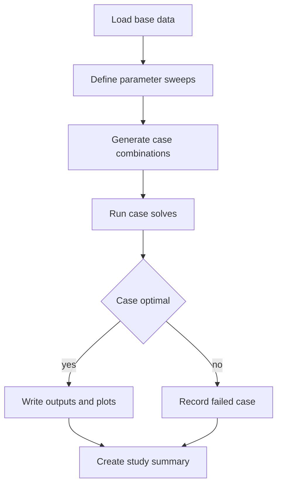

```{important}
**Windows users:** Every script that calls `study.run()` **must** guard
its entry point with `if __name__ == "__main__":`.  On Windows, Python
spawns child processes by re-importing the main script; without this
guard the script recurses infinitely.  This is a standard Python
requirement — see
[Safe importing of main module](https://docs.python.org/3/library/multiprocessing.html#the-spawn-and-forkserver-start-methods).
```

This repository example uses the two-area `Data/zonal_test/` fixture over
**168 hours (seven days)**, matching the strict `DailyBudgetFormulation`
case in `tests/test_zonal_daily_hydro_budget.py`. Its temporary input copy
adds profile-based hourly hydro maximum bounds and zero minimum bounds;
the canonical run-of-river fixture remains unchanged. This is an integration
fixture, not a calibrated real-world study.

Run from a repository checkout with development dependencies installed:

```bash
uv run python scripts/generate_zonal_documentation_examples.py
```

The [generation script](https://github.com/NatLabRockies/SDOM/blob/main/scripts/generate_zonal_documentation_examples.py)
runs the complete example below, checks that all 12 cases are optimal, and
refreshes the published plots and their
[numeric provenance](../_static/parametric_example/provenance.json).
All CSVs and complete per-case plot packs are written locally under
`results/zonal_documentation_168h/`.

```python
import logging
from pathlib import Path
from tempfile import TemporaryDirectory

from scripts.generate_zonal_documentation_examples import prepare_zonal_inputs
from sdom import configure_logging, get_default_solver_config_dict, load_data
from sdom.analytic_tools import plot_parametric_results
from sdom.parametric import ParametricStudy


def main():
    configure_logging(level=logging.INFO)

    with TemporaryDirectory(prefix="sdom_zonal_example_") as temporary:
        data_dir = prepare_zonal_inputs(
            Path("Data") / "zonal_test", Path(temporary) / "inputs"
        )
        data = load_data(str(data_dir))
        solver_cfg = get_default_solver_config_dict(
            solver_name="highs", executable_path=""
        )
        solver_cfg["solve_keywords"].update(
            tee=False, report_timing=False, keepfiles=False
        )
        study = ParametricStudy(
            base_data=data,
            solver_config=solver_cfg,
            n_hours=168,
            output_dir=str(Path("results") / "zonal_documentation_168h"),
            n_cores=3,
        )
        study.add_scalar_sweep("scalars", "GenMix_Target", [0.0, 0.8, 1.0])
        study.add_storage_factor_sweep("P_Capex", [1.0, 0.7])
        study.add_ts_sweep("load_data", [1.0, 1.4])
        results = study.run()

    failed = [r for r in results if not r.is_optimal]
    if len(results) != 12 or failed:
        raise RuntimeError(
            f"Expected 12 optimal cases; got {len(results)} results "
            f"and {len(failed)} unsuccessful cases."
        )
    plot_parametric_results(
        study,
        results,
        group_by=["GenMix_Target", "P_Capex"],
        hue_by="load_data",
        max_cases_per_figure=36,
        plot_per_case=True,
    )

    print(f"Total: {len(results)} | Optimal: {len(results)} | Failed: 0")
    for r in results:
        print(f"  cost={r.total_cost:>15,.0f}  status={r.solver_status}")


if __name__ == "__main__":
    main()

```

---

## Sample results of this example

The figures below are the actual outputs obtained by running the example above
(12 cases: `GenMix_Target` × 3, `P_Capex` × 2, `load` × 2) over 168 hours
with two zones. Generation and curtailment energy totals cover the modeled
seven days; capacity decisions remain in MW. The objective includes the
model's investment and operating costs and is not a weekly operating-cost bill.

### Cross-case sensitivity plots

**Installed capacity by technology**

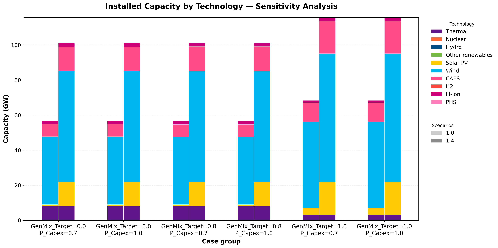

**Total generation by technology**

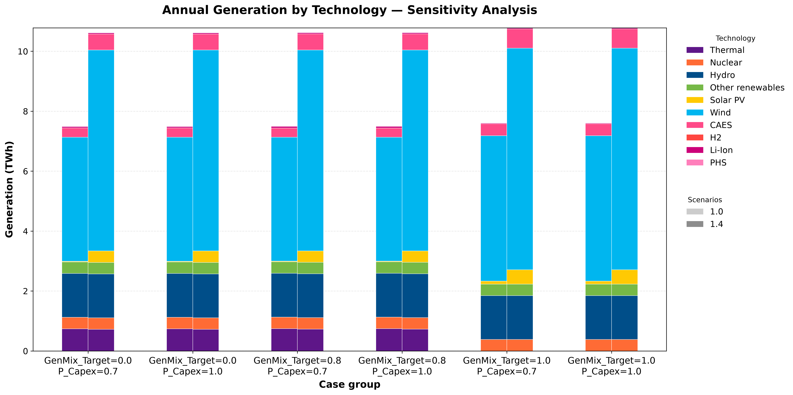

**VRE curtailment (absolute, MWh)**

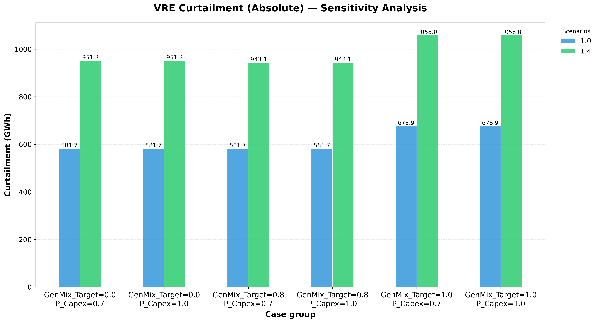

**VRE curtailment (percentage)**

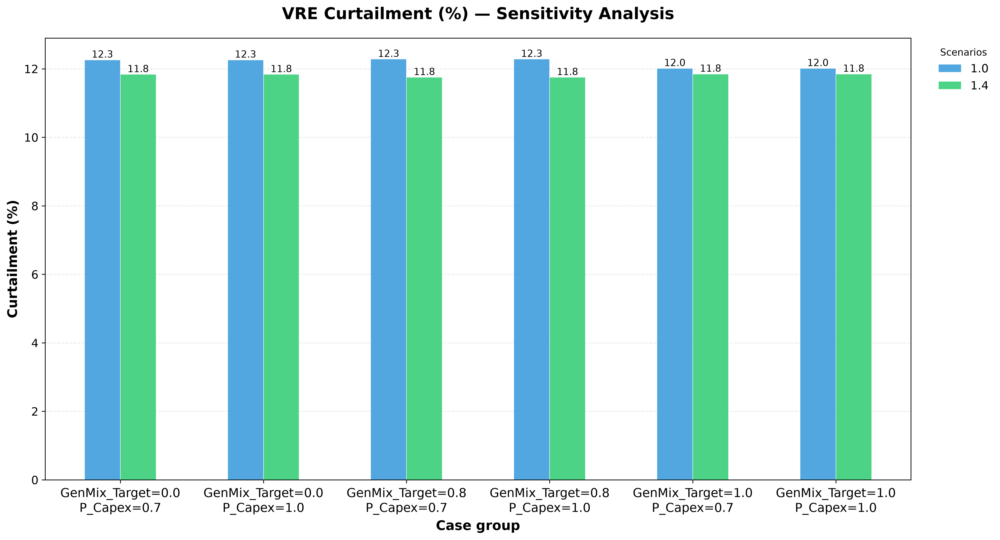

### Per-case plots

For each optimal case, individual figures are generated.
The sample below is from case `GenMix_Target=1.0 | P_Capex×1.0 | load×1.0`.

**Installed capacity donut**

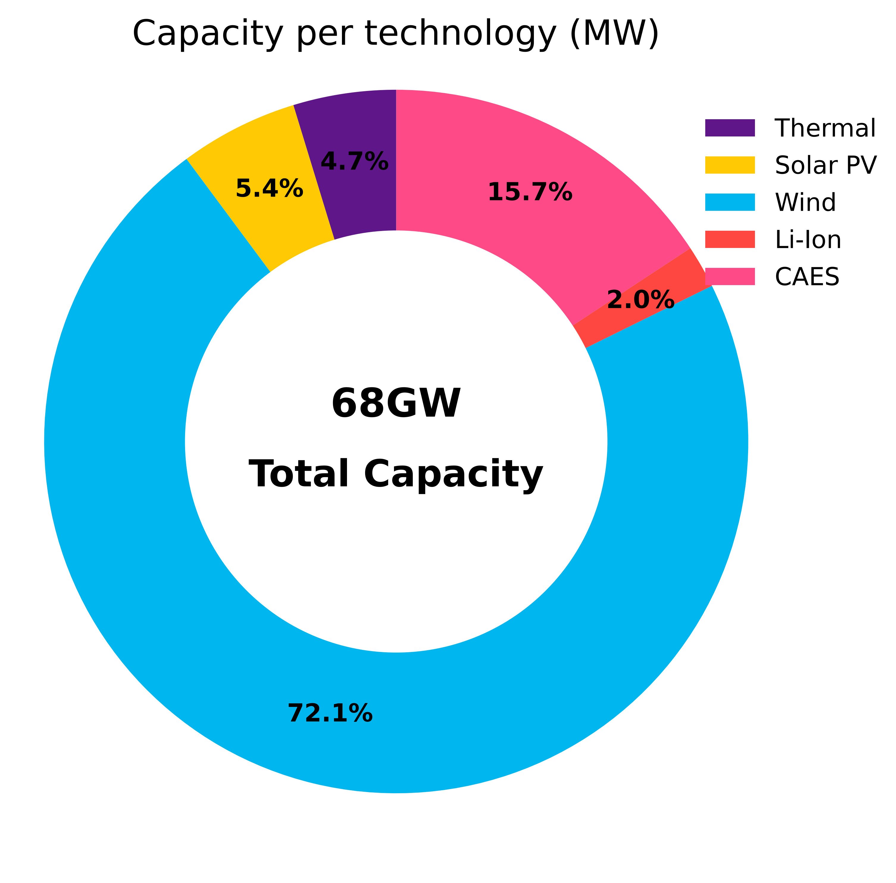

**Capacity and generation donuts (side by side)**

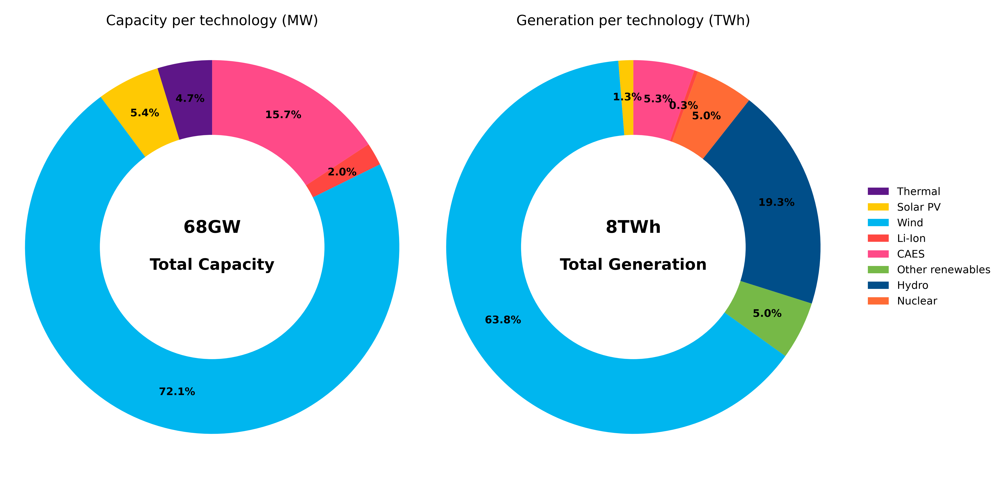

**Hourly dispatch heatmap — system VRE generation over seven days**

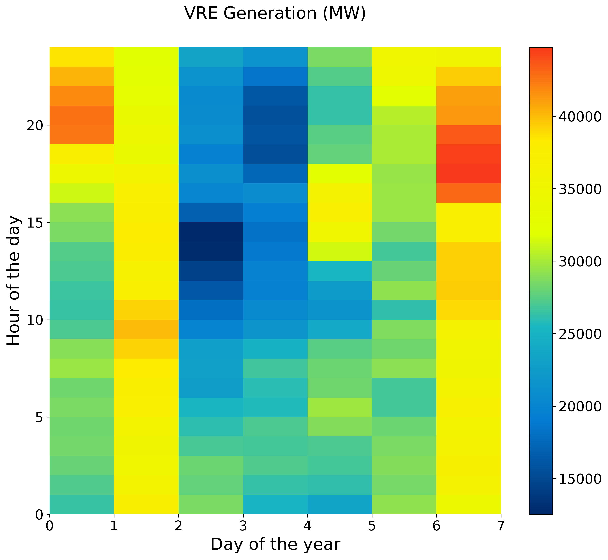

**Hourly dispatch heatmap — system net load over seven days**

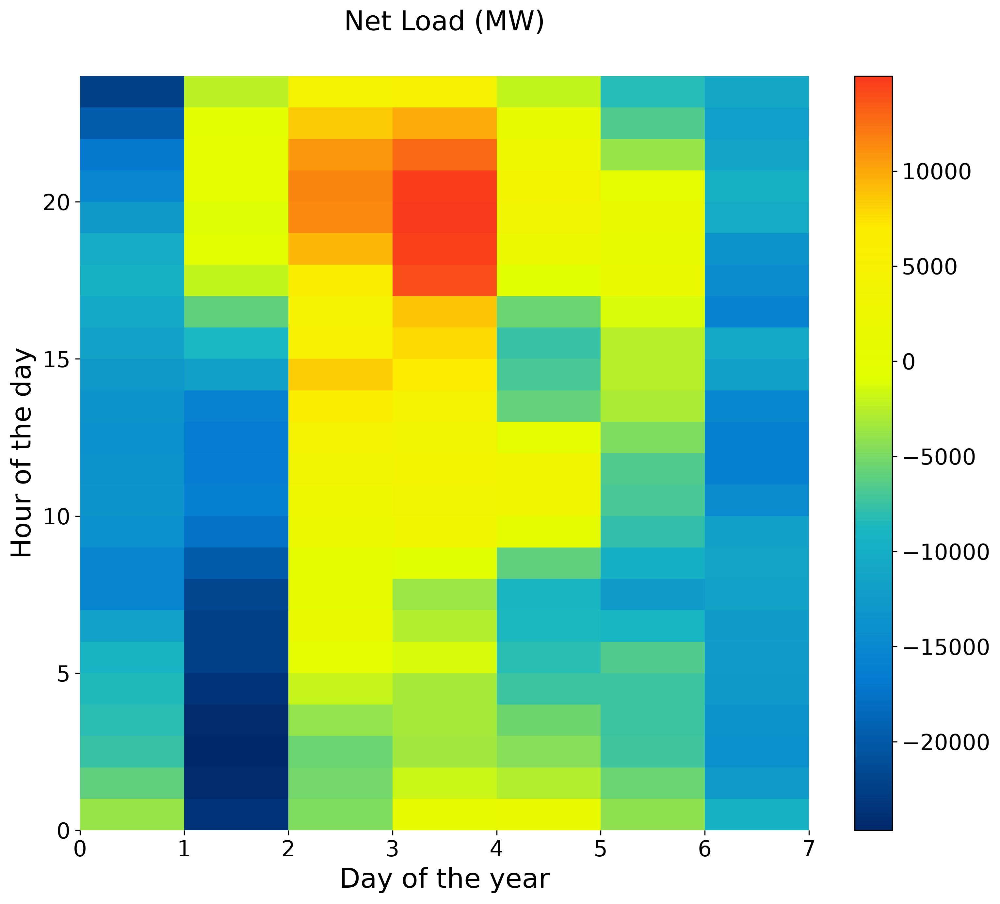

**Installed power capacity by zone**

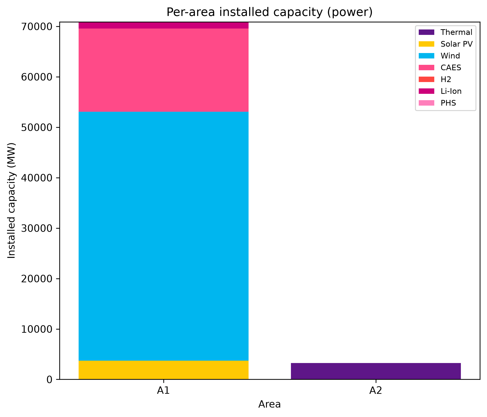

**System load duration curve**

Each system metric has a separate standalone figure. Points retain their original
hour-of-day colors, with interpolated 5%, 50%, and 95% duration markers.

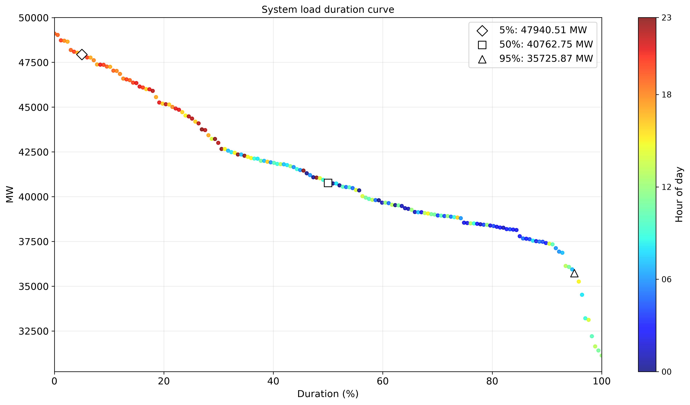

**Solar + wind curtailment percentage by zone**

Each panel independently sorts one zone's hourly percentages; both share the
00-23 hour color scale.

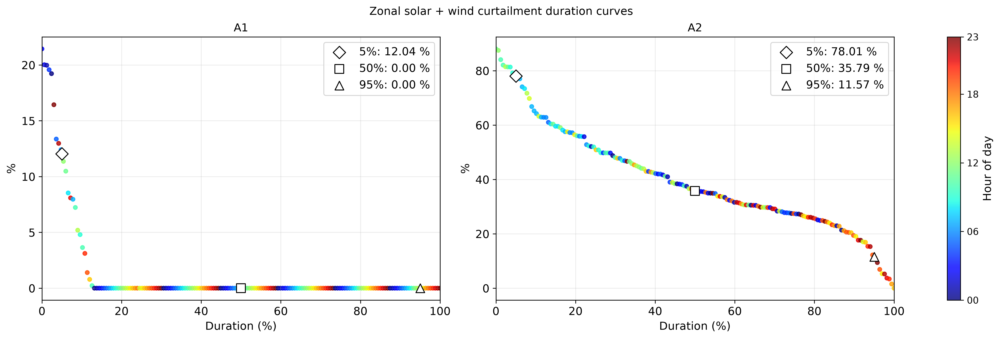

**Signed interregional flows over seven days**

The sign retains the line's defined direction; this is not zonal net interchange.

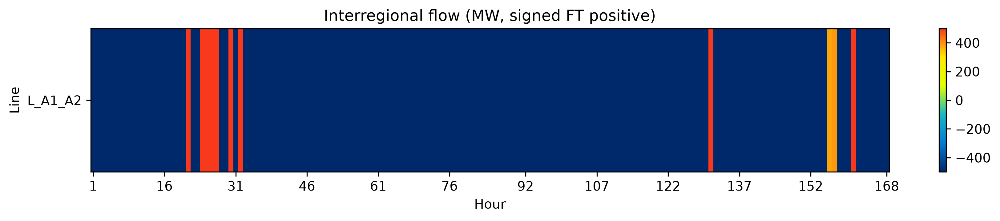

Each optimal per-case plot directory also includes the applicable duration
curves. Copperplate cases produce thermal-generation, hydropower, load, net-load, and combined
solar + wind curtailment (MW and %) curves, plus conditional imports, exports,
and marginal-price curves. They
also produce the copperplate marginal-price heatmap when at least 24 priced
hours are available. Zonal cases produce system thermal-generation, hydropower, load, and
net-load, external import/export, and combined solar + wind curtailment curves,
with separate system and per-zone subplot figures for each metric;
per-line signed-flow and per-zone marginal-price subplot figures;
annual generation and installed-capacity stacks by area; and a signed
line-flow heatmap when exchange data is available. These are individual case
artifacts only; they are not cross-case comparison curves. Set
``plot_per_case=False`` to suppress all per-case plots, including duration
curves, copperplate price heatmaps, and zonal per-area figures.

Per-case duration curves inherit the single-run scatter contract: descending
values on a 0-100% `Duration (%)` axis, `jet` colors retaining each observation's
original hour of day, and interpolated 5%, 50%, and 95% reference markers.
Zonal/line grids use bounded, adaptive pages with 16 pt minimum text and one
shared 00-23 hour scale. Each case also includes a combined LMP duration
comparison: selected zonal curves overlaid, or one copperplate curve.
Hourly curtailment percentages use combined solar + wind availability; zero
availability stays at 0%, and system percentages use ratios of hourly sums
rather than averages of zonal percentages. See
[generated figures](running_and_outputs.md#generated-figures) for the full
filename inventory and numerical definitions. Cross-case sensitivity plots
are unchanged.

The keyword-only `areas`, `page_size`, `max_panels_per_page`, `ncols`, and
`panel_aspect` options are forwarded to each per-case `plot_results` call.
Omitting `areas` includes all zones; supplying a sequence filters area-based
plots and the LMP overlay, not system totals or line plots. These options do not
change cross-case sensitivity charts and have no per-case effect when
`plot_per_case=False`. `max_cases_per_figure` remains the separate cap on
comparison bars. See
[grouped pages and area selection](running_and_outputs.md#readable-grouped-pages-and-area-selection)
for presets, validation and the `_partN` / `.pages.json` filename convention.

---

## Sweep types

### Scalar sweep — `add_scalar_sweep(data_key, param_name, values)`

Replaces a single entry in a row-indexed DataFrame with discrete absolute values.

```python
# data["scalars"].loc["GenMix_Target", "Value"] → 0.7, 0.8, …
study.add_scalar_sweep("scalars", "GenMix_Target", [0.7, 0.8, 0.9, 1.0])
```

### Storage factor sweep — `add_storage_factor_sweep(param_name, factors)`

Multiplies the entire `data["storage_data"].loc[param_name]` row (all
storage technologies) by each factor uniformly.

```python
# data["storage_data"].loc["P_Capex"] *= 0.7  /  *= 0.8  /  *= 1.0
study.add_storage_factor_sweep("P_Capex", [0.7, 0.8, 1.0])
```

### Time-series sweep — `add_ts_sweep(ts_key, factors)`

Multiplies the numeric column of a time-series DataFrame by each factor.
The column name is resolved automatically:

| `ts_key` | Column scaled |
|---|---|
| `"load_data"` | `"Load"` |
| `"large_hydro_data"` | `"LargeHydro"` |
| `"large_hydro_max"` | `"LargeHydro_max"` |
| `"large_hydro_min"` | `"LargeHydro_min"` |
| `"cap_imports"` | `"Imports"` |
| `"price_imports"` | `"Imports_price"` |
| `"cap_exports"` | `"Exports"` |
| `"price_exports"` | `"Exports_price"` |

```python
study.add_ts_sweep("load_data", [0.9, 1.0, 1.1])
study.add_ts_sweep("large_hydro_max", [0.8, 1.0])
```

---

## Cartesian product and case naming

Every combination of all registered sweeps is evaluated.  A study with
3 scalar values, 2 storage factors, and 3 load factors produces
**3 × 2 × 3 = 18 cases**.

Each case receives a deterministic, filesystem-safe name derived from its
parameter values, for example:

```
GenMix_Target=0.90_P_Capexx0.8_load_datax1.05
```

This name is used as the `case_name` in `run_solver` and as the
sub-directory name under `output_dir`.

```{note}
If two combinations happen to produce the same safe name after character
substitution (e.g. both `1.0/2` and `1.0_2` collapse to `1.0_2`), SDOM
automatically appends the case's Cartesian-product index as a suffix
(`<name>_<index>`) so every case directory is always unique.
```

---

## Output structure

Running the example above produces the following layout under `output_dir`:

```
Data/no_exchange_run_of_river/results/
├── GenMix_Target=0.0_P_Capexx0.7_load_datax1.0/
│   ├── OutputGeneration_<case_name>.csv
│   ├── OutputStorage_<case_name>.csv
│   ├── OutputSummary_<case_name>.csv
│   ├── OutputThermalGeneration_<case_name>.csv
│   ├── OutputInstalledPowerPlants_<case_name>.csv
│   └── plots/
│       ├── capacity_donut.png
│       ├── capacity_generation_donuts.png
│       ├── heatmap_VRE_Generation_(MW).png
│       ├── heatmap_All_Thermal_Generation_(MW).png
│       ├── heatmap_Hydro_Generation_(MW).png
│       ├── heatmap_Nuclear_Generation_(MW).png
│       ├── heatmap_Other_Renewables_Generation_(MW).png
│       ├── heatmap_Storage_Charge_Discharge_(MW).png
│       ├── heatmap_Load_(MW).png
│       └── heatmap_Net_Load_(MW).png
│       ├── duration_curve_total_thermal_generation.png
│       ├── duration_curve_load.png
│       ├── duration_curve_net_load.png
│       ├── duration_curve_marginal_price.png
│       └── heatmap_marginal_price.png
├── GenMix_Target=0.0_P_Capexx0.7_load_datax1.4/
│   └── ...                                        # same structure, 11 more cases
├── ...
├── sensitivity_plots/
│   ├── capacity_comparison.png
│   ├── generation_comparison.png
│   ├── curtailment_absolute.png
│   ├── curtailment_percentage.png
│   └── cost_comparison.png
└── parametric_summary.csv
```

`parametric_summary.csv` has one row per case and always includes:

| Column | Description |
|---|---|
| `case_name` | Unique identifier |
| `<data_key>.<param_name>` | Value used for each scalar sweep |
| `storage_data.<param>_factor` | Factor used for each storage sweep |
| `<ts_key>_factor` | Factor used for each ts sweep |
| `is_optimal` | `True` if the solver found an optimal solution |
| `total_cost` | Objective value (USD) |
| `solver_status` | Solver status string |
| `termination_condition` | Solver termination condition |

---

## Performance guidance

- **`n_cores`** — Each worker process builds its own Pyomo model and runs
  the solver independently.  Memory consumption scales roughly linearly with
  the number of *concurrent* workers — not with the total sweep size — because
  each worker deep-copies the base data **inside its own process** (lazy copy),
  so the parent process holds only one copy of the data at all times.
  A safe starting point is 4 workers; increase only if memory usage is comfortable.
  Pass `n_cores=None` to use all available cores minus one.

- **Large sweeps** — For 50+ cases, consider whether `output_dir` is on a
  fast local disk; solver log files (HiGHS/CBC) are written per process and
  may create I/O contention on networked drives.

- **`n_hours=72` for debugging** — Use a short horizon to verify sweep
  logic and case naming before committing to a full 8760-hour run.

- **Failed cases** — `ParametricStudy.run()` never raises on individual case
  failures.  Inspect `result.is_optimal` and `result.termination_condition`
  per result, and check `parametric_summary.csv` for a consolidated view.
  Failed cases have `total_cost=NaN` in the summary so they are
  distinguishable from valid zero-cost results.

---

## Visualising parametric results

After calling `study.run()`, use `plot_parametric_results()` from the
`analytic_tools` sub-package to automatically produce:

- **Per-case plots** — capacity donut, capacity + generation donuts, and
  hourly dispatch heatmaps and applicable duration curves for every optimal case, saved under
  `<output_dir>/<case_name>/plots/`.
- **Cross-case comparison plots** — grouped stacked-bar charts for installed
  capacity, total generation, VRE curtailment, and CAPEX + OPEX costs by
  technology, saved under `<output_dir>/sensitivity_plots/`.

  | File | Description |
  |---|---|
  | `capacity_comparison.png` | Installed capacity by technology (GW) |
  | `generation_comparison.png` | Annual generation by technology (TWh) |
  | `curtailment_absolute.png` | VRE curtailment in absolute terms (GWh) |
  | `curtailment_percentage.png` | VRE curtailment as percentage of total generation |
  | `cost_comparison.png` | CAPEX (solid) and OPEX (hatched) by technology ($M USD) |

The call used in the example script is:

```python
plot_parametric_results(
    study,
    results,
    group_by=["GenMix_Target", "P_Capex"],   # x-axis clusters
    hue_by="load_data",                       # bars colour-coded by load factor
    max_cases_per_figure=36,
    plot_per_case=True,
)
```

### Grouping strategy

Use `group_by`, `hue_by`, and `facet_by` to control how cases are arranged.
Pass the same name that was registered with the sweep methods.

| Parameter | Role |
|---|---|
| `group_by` | X-axis clusters — one cluster per unique combination of values (required) |
| `hue_by` | Bars within each cluster, colour-coded by this dimension (optional) |
| `facet_by` | One complete figure per unique value of this dimension (optional) |

```{tip}
Dimension names must match exactly the names registered with the sweep
methods.  Use `study.case_metadata[0].keys()` to inspect available names
after a run.
```

---

### Additional options

**Skip per-case plots** (faster for large sweeps):

```python
plot_parametric_results(study, results, group_by="GenMix_Target", plot_per_case=False)
```

Setting `plot_per_case=False` also suppresses duration curves because they are
generated only by the single-case plotting route.

**Override the output directory**:

```python
plot_parametric_results(study, results, group_by="GenMix_Target",
                        output_dir="./my_output/")
```

**Limit cases per figure** (auto-splits into `part1.png`, `part2.png`, …):

```python
plot_parametric_results(study, results, group_by="GenMix_Target",
                        max_cases_per_figure=12)
```

**Faceted figures** (one complete figure per load factor):

```python
plot_parametric_results(
    study, results,
    group_by="GenMix_Target",
    hue_by="P_Capex",
    facet_by="load_data",
)
```

