# Pyomo Model Blocks and Input Provenance

This reference describes the investment/dispatch model returned by
`initialize_model`: where components live, their Pyomo types, and how CSV
inputs become mathematical quantities. It complements the
[copperplate formulation](sdom_math_formulation.md),
[zonal formulation](zonal_math_formulation.md), and
[interactive inspection guide](exploring_model.md).
The separate outage models built by `evaluate_resiliency` are described in
the [resiliency formulation](resiliency_math.md), not inventoried here.

## Composition and conventions

A **host** is the copperplate `model` or a zonal `model.area[a]`.
Builders reuse the same technology blocks on either host.
The diagrams use **nested containers to show ownership**. Containers named
`model`, `area[a]`, or a technology are actual model/Block boundaries.
Inner **Parameters**, **Variables**, **Expressions**, and **Constraints**
containers are visual field groups, **not additional Pyomo Blocks**.
Invisible layout links only arrange the boxes; they do not represent data flow.

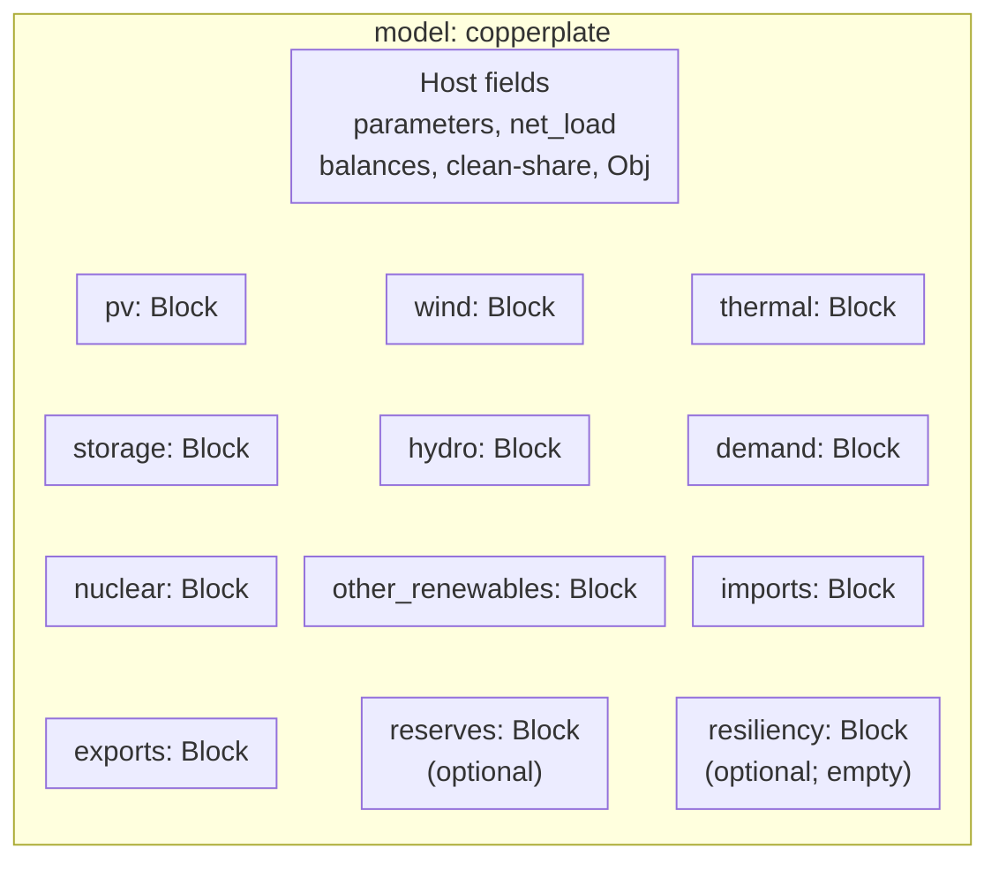

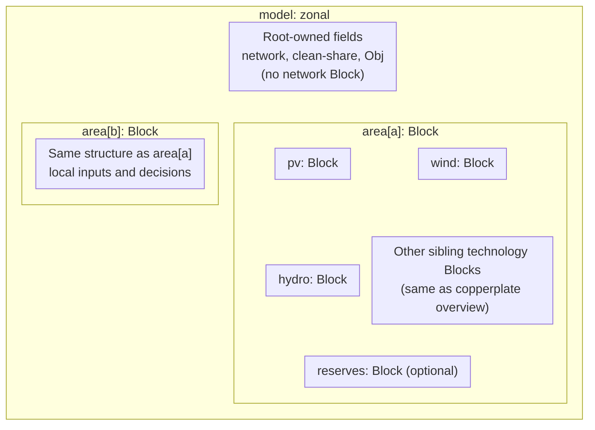

Comma-separated names in a box are sibling Blocks, not an extra container.
The zonal diagram shows two representative areas; `area[a]` is repeated for
every member of `model.A`. The detailed field-group diagrams below apply to
each area's technology Blocks as well as the copperplate host.
**Block existence does not imply active technology.** All ten technology
blocks are created even for empty fleets. `reserves` is created only when its
formulation is enabled. `resiliency` is an optional copperplate placeholder;
the legacy fields and constraints are on the host. Zonal mode rejects legacy
resilience constraints and enabled external imports/exports.

Read the tables as follows:

- `Param` is input or derived fixed data; `Var` is a solver decision;
  `Expression` is an attached symbolic formula, not an independent decision.
  `Set` supplies indices. `Entry` denotes an entry in a property-matrix Param,
  not another component.
- Names are **local to the block**: `generation[h,k]` in the thermal table
  means `model.thermal.generation[h,k]` or
  `model.area[a].thermal.generation[h,k]`.
- `h` indexes one-hour steps, $k$ a plant, $j$ storage, $b$ a hydro period,
  $a$ an area, and $\ell$ a line. Zonal symbols add the area index to local
  quantities; Python index order need not match mathematical subscript order.
- `scalars.csv: X` means the row with `Parameter=X`, column `Value`.
  `StorageData.csv: X, j` means row `X` in the first-column property index,
  technology column `j`. Other `file: column` references are column names.
- CSV loading rounds most numeric technology/profile data to five decimals.
  Scalars and validated thermal minimum-dispatch fractions retain their
  validation-specific handling. Parameters retain their tabulated units:
  the cost formulas, **not** the CAPEX/FOM Params, apply the factor $10^3$.
- Requested `n_hours` determines the horizon, rounded **up** to complete
  24-hour daily or 730-hour monthly hydro periods. All hourly fields use this
  effective horizon. Fixed costs are annual USD/year; dispatch costs are USD
  over modeled hours and are not annualized for a shortened run.

For zonal provenance, `area_id` in `CapSolar.csv`, `CapWind.csv`, and
`Data_BalancingUnits.csv` selects the host. Wide columns such as `Load@A1@`
or `Li-Ion@A1@` are split by area and their tags removed before the same
builders run. CF headers identify plants and may be area-tagged; ownership
must agree with the capacity table. Thermal minimum-dispatch headers are
globally unique plant IDs, **not** area-tagged.
Areas without a profile/technology receive empty fleets or zero profiles;
absent budget hydro also receives zero lower/upper bounds. See the exact
[base schemas](inputs.md) and [zonal slicing rules](zonal_inputs.md).

## Host

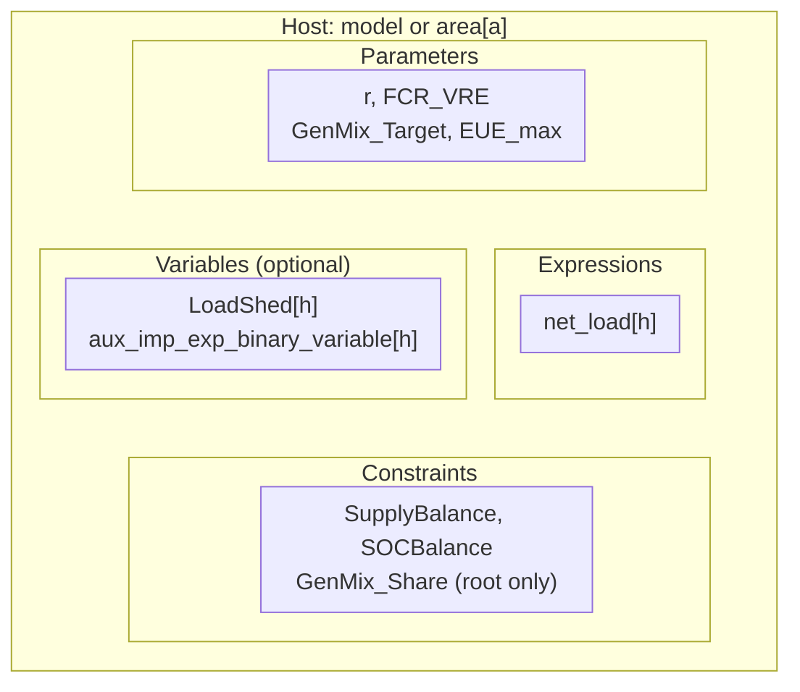

| Member | Kind | Mathematical meaning / units | Input provenance or definition |
| --- | --- | --- | --- |
| `h` | Set | $\mathcal H$, one-based hours | Effective `initialize_model(..., n_hours=...)` horizon, not a CSV scalar. |
| `r` | Param | $r$, dimensionless discount rate | `scalars.csv: r`. |
| `FCR_VRE` | Param | $a^{vre}$, inverse years | Derived $\operatorname{CRF}(r,l^{vre})$ from `scalars.csv: r` and `l_vre`. |
| `GenMix_Target` | Param | $\tau$, clean-generation fraction | `scalars.csv: GenMix_Target`; mutable. Area copies exist, but zonal clean share uses the root Param. |
| `EUE_max` | Param | $EUE^{max}$, MWh | `scalars.csv: EUE_max`; mutable, declared even without legacy resilience constraints. |
| `net_load[h]` | Expression | $n_h$, MW | Gross demand minus fixed nuclear/other renewables and scheduled hydro, minus `pv`/`wind` hourly availability (generation **plus** curtailment). No direct input column. |
| `LoadShed[h]` | Var | $L_h\ge0$, MW | Only with legacy resilience constraints; no CSV value initializes the decision. |
| `aux_imp_exp_binary_variable[h]` | Var | $V_h\in\{0,1\}$ | Only with net-load-coupled external trade; not used for zonal line flows. |

The root objective `Obj` minimizes fixed investment/O&M plus thermal fuel/VOM,
storage discharge VOM, signed technology curtailment costs, and, in
copperplate mode, imports expenditure **minus** exports revenue.
Zonal `Obj` sums local costs once across areas; transmission investment cost
is currently zero. Area hosts have no separate objective or clean-share
constraint. `SupplyBalance` and storage `SOCBalance` live on each host, even
though most other operating constraints live inside technology blocks.

## PV and wind

Both blocks have the same schema. Use `CapSolar.csv`/`CFSolar.csv` for `pv`
and `CapWind.csv`/`CFWind.csv` for `wind`. In the table, `Cap*.csv` and
`CF*.csv` mean these exact corresponding files. Generic $P_k,F_k,G_h,C_h$
stand for the formulation's PV or wind quantities: $k=p$ or $w$,
$F_k=F^{pv}_p$ or $F^{wind}_w$, $G_h=G^{pv}_h$ or $G^{wind}_h$,
and $C_h=C^{pv}_h$ or $C^{wind}_h$. Likewise $\kappa_k,\phi_k,t_k$
denote $\kappa^{pv}_p,\phi^{pv}_p,\kappa^{tc,pv}_p$ or their wind
counterparts, and $CF_{kh}$ denotes $\sigma_{ph}$ or $\zeta_{wh}$.
The formulation's cost symbols use converted per-MW units; the table
therefore maps raw per-kW Params to these symbols divided by $10^3$.
Derived capacity/energy/cost totals and annualization factors use descriptive
aliases when the mathematical formulation does not name them individually.

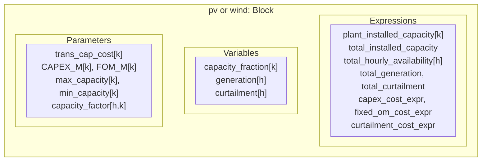

| Member | Kind | Mathematical meaning / units | Input provenance or definition |
| --- | --- | --- | --- |
| `plants_set` | Set | $\mathcal P$ or $\mathcal W$ | Selected CF plant headers, matched to `Cap*.csv: sc_gid`; optional `vre_plants` selection filters both. |
| `properties_set` | Set | Cost-property names | Code-defined `trans_cap_cost`, `CAPEX_M`, `FOM_M`; not a set-file input. |
| `trans_cap_cost[k]` | Param | $t_k$, USD/MW | `Cap*.csv: trans_cap_cost`, keyed by `sc_gid`. |
| `CAPEX_M[k]` | Param | $\kappa_k/10^3$, USD/kW | `Cap*.csv: CAPEX_M`, keyed by `sc_gid`. |
| `FOM_M[k]` | Param | $\phi_k/10^3$, USD/kW/year | `Cap*.csv: FOM_M`, keyed by `sc_gid`. |
| `max_capacity[k]` | Param | $\bar p_k$, MW | `Cap*.csv: capacity` (lowercase). |
| `min_capacity[k]` | Param | $\underline p_k$, MW | Optional `Cap*.csv: MinCapacity`; omitted/blank/NaN defaults to zero. |
| `capacity_factor[h,k]` | Param | $CF_{kh}$, dimensionless | `CF*.csv: <plant_id>`, aligned to the modeled one-based hours and plant IDs. |
| `capacity_fraction[k]` | Var | $F_k\in[0,1]$ | Investment fraction, lower-bounded by `min_capacity/max_capacity` for positive maximum capacity; zero-maximum sites are fixed to zero. |
| `generation[h]` | Var | $G_h\ge0$, MW | Aggregate dispatched generation, not plant-indexed dispatch. |
| `curtailment[h]` | Var | $C_h\ge0$, MW | Aggregate unused available output. |
| `plant_installed_capacity[k]` | Expression | $P_k$, MW | `max_capacity[k] * capacity_fraction[k]`; **not a Var**. |
| `total_installed_capacity` | Expression | $\sum_kP_k$, MW | Sum of plant capacity expressions. |
| `total_hourly_availability[h]` | Expression | $A_h=G_h+C_h$, MW | Generation plus curtailment; the VRE balance equates this to $\sum_kCF_{kh}P_k$. |
| `total_generation` | Expression | $\sum_hG_h$, MWh | Sum over effective one-hour steps. |
| `total_curtailment` | Expression | $\sum_hC_h$, MWh | Sum over effective one-hour steps. |
| `fixed_om_cost_expr` | Expression | $Z^{FOM}$, USD/year | $\sum_k\phi_kP_k$, with $\phi_k=10^3\,\text{FOM_M}[k]$. |
| `capex_cost_expr` | Expression | $Z^{cap}$, USD/year | Host `FCR_VRE` times $\sum_k(\kappa_k+t_k)P_k$, with $\kappa_k=10^3\,\text{CAPEX_M}[k]$. |
| `curtailment_cost_expr` | Expression | $Z^{curt,pv}$ or $Z^{curt,wind}$, USD | `scalars.csv: SolarCurtailmentCost` ($c^{solar}$) or `WindCurtailmentCost` ($c^{wind}$) times `total_curtailment`; absent/zero rate gives constant zero. |

Curtailment rates are finite, signed **Python coefficients**, not separately
attached Pyomo Params. Each can be activated independently. Empty fleets have
zero costs. The VRE balance and capacity bounds are detailed in the
[VRE constraints](sdom_math_formulation.md#vre-balance-constraints).

## Thermal

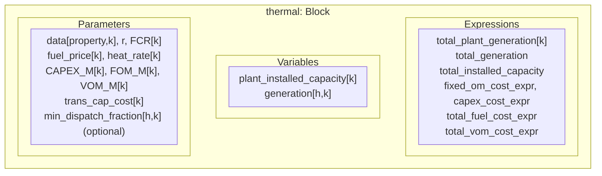

All property entries below come from **`Data_BalancingUnits.csv`**, keyed by
column `Plant_id`. Dedicated Params copy the same values from `data`.
Fuel price $c^{fuel}_k$ and heat rate $HR_k$ are the input decomposition of
the formulation's marginal fuel cost $\gamma_k=c^{fuel}_kHR_k$.

| Member | Kind | Mathematical meaning / units | Input provenance or definition |
| --- | --- | --- | --- |
| `plants_set` | Set | $\mathcal K$, thermal plants | `Data_BalancingUnits.csv: Plant_id`, normalized to strings. |
| `properties_set` | Set | Eight thermal properties | Code-defined property names inventoried below. |
| `data[property,k]` | Param | Static thermal property matrix | `Data_BalancingUnits.csv: <property>`, row `Plant_id=k`. |
| `data["MinCapacity",k]` | Entry | $\underline p^{bal}_k$, MW | Column `MinCapacity`. |
| `data["MaxCapacity",k]` | Entry | $\bar p^{bal}_k$, MW | Column `MaxCapacity`. |
| `data["Lifetime",k]` | Entry | $l^{bal}_k$, years | Column `Lifetime`; input to `FCR[k]`. |
| `data["Capex",k]` | Entry | $\kappa^{bal}_k/10^3$, USD/kW | Column `Capex`. |
| `data["HeatRate",k]` | Entry | $HR_k$, MMBtu/MWh | Column `HeatRate`. |
| `data["FuelCost",k]` | Entry | $c^{fuel}_k$, USD/MMBtu | Column `FuelCost`. |
| `data["VOM",k]` | Entry | $\psi^{bal}_k$, USD/MWh | Column `VOM`. |
| `data["FOM",k]` | Entry | $\phi^{bal}_k/10^3$, USD/kW/year | Column `FOM`. |
| `fuel_price[k]` | Param | $c^{fuel}_k$, USD/MMBtu | `Data_BalancingUnits.csv: FuelCost`. |
| `heat_rate[k]` | Param | $HR_k$, MMBtu/MWh | `Data_BalancingUnits.csv: HeatRate`. |
| `CAPEX_M[k]` | Param | $\kappa^{bal}_k/10^3$, USD/kW | `Data_BalancingUnits.csv: Capex`. |
| `FOM_M[k]` | Param | $\phi^{bal}_k/10^3$, USD/kW/year | `Data_BalancingUnits.csv: FOM`. |
| `VOM_M[k]` | Param | $\psi^{bal}_k$, USD/MWh | `Data_BalancingUnits.csv: VOM`. |
| `trans_cap_cost[k]` | Param | $t_k=0$, USD/MW | Code-defined zero; no thermal transmission-cost CSV column. |
| `r` | Param | $r$, dimensionless | `scalars.csv: r`. |
| `FCR[k]` | Param | $a_k=\operatorname{CRF}(l^{bal}_k)$, inverse years | Derived using `scalars.csv: r` and `Data_BalancingUnits.csv: Lifetime`. |
| `min_dispatch_fraction[h,k]` | Param | $q^{bal}_{kh}\in[0,1]$ | Only `NoRampsMinDispatchFormulation`: `Thermal_MinDispatchFraction.csv: <Plant_id>`, indexed by `Hour` or `*Hour`. |
| `plant_installed_capacity[k]` | Var | $P^{bal}_k\ge0$, MW | Bounds are `data["MinCapacity",k]` and `data["MaxCapacity",k]`. |
| `generation[h,k]` | Var | $G^{bal}_{kh}\ge0$, MW | Upper bound is installed capacity; selected minimum-dispatch formulation also imposes its hourly fraction times installed capacity. |
| `total_plant_generation[k]` | Expression | $E^{bal}_k$, MWh | $\sum_hG^{bal}_{kh}$. |
| `total_generation` | Expression | $E^{bal}$, MWh | Sum of `total_plant_generation`. |
| `total_installed_capacity` | Expression | $P^{bal,tot}$, MW | Sum of installed plant capacities. |
| `fixed_om_cost_expr` | Expression | $Z^{bal,FOM}$, USD/year | $\sum_k\phi^{bal}_kP^{bal}_k$, using converted FOM. |
| `capex_cost_expr` | Expression | $Z^{bal,cap}$, USD/year | $\sum_ka_k(\kappa^{bal}_k+t_k)P^{bal}_k$, using converted CAPEX. |
| `total_fuel_cost_expr` | Expression | $Z^{fuel}$, USD | $\sum_kc^{fuel}_kHR_kE^{bal}_k$. |
| `total_vom_cost_expr` | Expression | $Z^{VOM}$, USD | $\sum_k\psi^{bal}_kE^{bal}_k$. |

There are no ramping, start-up, or unit-commitment variables in these thermal
formulations. See [thermal constraints](sdom_math_formulation.md#balancing-unit-constraints).

## Storage

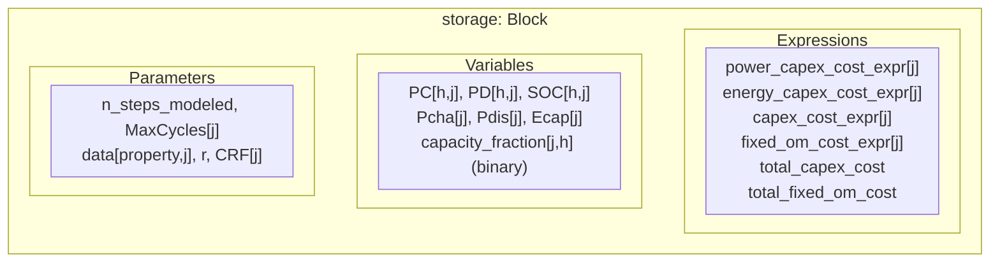

`StorageData.csv` uses property rows and technology columns, unlike the
row-oriented thermal/VRE tables. `MaxCycles` is a separate Param, **not** an
entry of `storage.data`.

| Member | Kind | Mathematical meaning / units | Input provenance or definition |
| --- | --- | --- | --- |
| `j` | Set | $\mathcal J$, storage technologies | `StorageData.csv` technology column headers after area slicing. |
| `b` | Set | $\mathcal J^c$, coupled technologies | Subset whose `StorageData.csv: Coupled, j` equals `1`. |
| `properties_set` | Set | Eleven storage properties | Code-defined property names inventoried below. |
| `n_steps_modeled` | Param | $N=\operatorname{card}(\mathcal H)$, hours | Derived from the effective model horizon. |
| `MaxCycles[j]` | Param | $\kappa^{cyc}_j$, lifetime cycles | `StorageData.csv: MaxCycles, j`; annual allowance is `MaxCycles/Lifetime`, not prorated for shorter horizons. |
| `data[property,j]` | Param | Static storage property matrix | `StorageData.csv: <property>, j`. |
| `data["P_Capex",j]` | Entry | $\kappa^P_j/10^3$, USD/kW | Row `P_Capex`, column `j`. |
| `data["E_Capex",j]` | Entry | $\kappa^E_j/10^3$, USD/kWh | Row `E_Capex`, column `j`. |
| `data["Eff",j]` | Entry | $\eta_j$, roundtrip efficiency | Row `Eff`, column `j`; charge/discharge efficiencies are $\sqrt{\eta_j}$. |
| `data["Min_Duration",j]` | Entry | $\underline\delta_j$, hours | Row `Min_Duration`, column `j`. |
| `data["Max_Duration",j]` | Entry | $\overline\delta_j$, hours | Row `Max_Duration`, column `j`. |
| `data["Max_P",j]` | Entry | $\bar p^{stor}_j$, MW | Row `Max_P`, column `j`. |
| `data["Coupled",j]` | Entry | Coupling flag, dimensionless | Row `Coupled`, column `j`; also determines membership in `b`. |
| `data["FOM",j]` | Entry | $\phi^{stor}_j/10^3$, USD/kW/year | Row `FOM`, column `j`. |
| `data["VOM",j]` | Entry | $\psi^{stor}_j$, USD/MWh | Row `VOM`, column `j`; applies to discharge only. |
| `data["Lifetime",j]` | Entry | $l^{stor}_j$, years | Row `Lifetime`, column `j`. |
| `data["CostRatio",j]` | Entry | $\alpha_j$, dimensionless | Row `CostRatio`, column `j`; share of power CAPEX/FOM assigned to charging. |
| `r` | Param | $r$, dimensionless | `scalars.csv: r`. |
| `CRF[j]` | Param | $a_j=\operatorname{CRF}(l^{stor}_j)$, inverse years | Derived using `scalars.csv: r` and storage `Lifetime`. |
| `PC[h,j]` | Var | $D^{ch}_{jh}\ge0$, MW | Hourly charging decision. |
| `PD[h,j]` | Var | $D^{dis}_{jh}\ge0$, MW | Hourly discharging decision. |
| `SOC[h,j]` | Var | $S_{jh}\ge0$, MWh | End-of-hour stored energy; first-hour balance wraps to final-hour SOC. |
| `Pcha[j]` | Var | $P^{ch}_j\ge0$, MW | Installed charging power. |
| `Pdis[j]` | Var | $P^{dis}_j\ge0$, MW | Installed discharging power. |
| `Ecap[j]` | Var | $E_j\ge0$, MWh | Installed energy capacity. |
| `capacity_fraction[j,h]` | Var | $U_{jh}\in\{0,1\}$ | Operating mode: one permits charging, zero discharging; **not** an investment fraction. |
| `power_capex_cost_expr[j]` | Expression | $Z^{P,cap}_j$, USD/year | $a_j\kappa^P_j[\alpha_jP^{ch}_j+(1-\alpha_j)P^{dis}_j]$, using converted power CAPEX. |
| `energy_capex_cost_expr[j]` | Expression | $Z^{E,cap}_j$, USD/year | $a_j\kappa^E_jE_j$, using converted energy CAPEX. |
| `capex_cost_expr[j]` | Expression | $Z^{cap}_j$, USD/year | Power plus energy CAPEX expressions. |
| `fixed_om_cost_expr[j]` | Expression | $Z^{FOM}_j$, USD/year | $\phi^{stor}_j[\alpha_jP^{ch}_j+(1-\alpha_j)P^{dis}_j]$, using converted FOM. |
| `total_capex_cost` | Expression | $Z^{cap}$, USD/year | Sum over technologies. |
| `total_fixed_om_cost` | Expression | $Z^{FOM}$, USD/year | Sum over technologies. |

Storage VOM $\sum_{j,h}\psi^{stor}_jD^{dis}_{jh}$ is inserted into `Obj`
by `add_storage_variable_costs`; there is **no attached VOM Expression**
on `storage`. The host owns `SOCBalance`; the storage block owns its remaining
power, SOC, duration, coupling, and cycling limits. See
[storage constraints](sdom_math_formulation.md#storage-constraints).

## Hydro

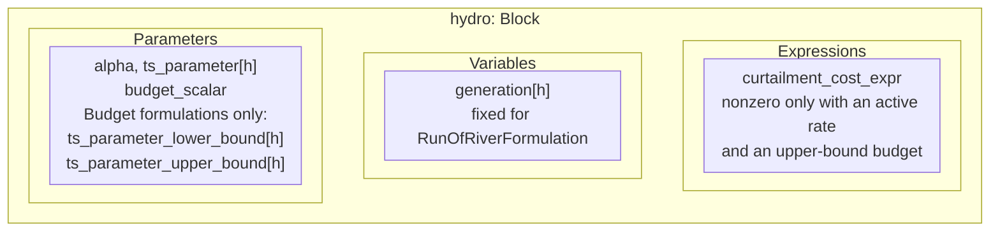

| Member | Kind | Mathematical meaning / units | Input provenance or definition |
| --- | --- | --- | --- |
| `alpha` | Param | $\alpha^{hyd}$, dimensionless | `scalars.csv: AlphaLargHy`. |
| `ts_parameter[h]` | Param | $\rho_h$, MW | `lahy_hourly.csv: LargeHydro`; unscaled reference profile. |
| `budget_scalar` | Param | Period length, hours | Derived from `formulations.csv`: `Component=Hydro`, column `Formulation`; `1` for run-of-river, `24` daily, `730` monthly. |
| `ts_parameter_upper_bound[h]` | Param | $\overline g^{hyd}_h$, MW | Budget formulations only: `lahy_max_hourly.csv: LargeHydro`. |
| `ts_parameter_lower_bound[h]` | Param | $\underline g^{hyd}_h$, MW | Budget formulations only: `lahy_min_hourly.csv: LargeHydro`. |
| `budget_set` | Set | $\mathcal B$, complete periods | Budget formulations only: `range(1, N / budget_scalar + 1)`. |
| `generation[h]` | Var | $G^{hyd}_h\ge0$, MW | Run-of-river fixes it to `alpha * ts_parameter`; budget formulations dispatch between alpha-scaled hourly bounds. |
| `curtailment_cost_expr` | Expression | $Z^{curt,hyd}$, USD | `scalars.csv: HydroCurtailmentCost` ($c^{hydro}$) times $\sum_h(\rho_h-G^{hyd}_h)$ only for daily/monthly **upper-bound** budgets; otherwise constant zero. |

Period energy $\epsilon_b=\sum_{h\in\mathcal H_b}\rho_h$ is formed directly
inside budget constraints; there is no separate budget-energy Param or
Expression. `alpha` scales dispatch bounds, **not** period budgets or
curtailment availability. Equality budgets require generation to equal
$\epsilon_b$; upper-bound budgets allow less. The signed curtailment formula
retains the availability constant and does not clip hourly differences.
See [hydro constraints](sdom_math_formulation.md#hydro-budget-constraints).

## Demand

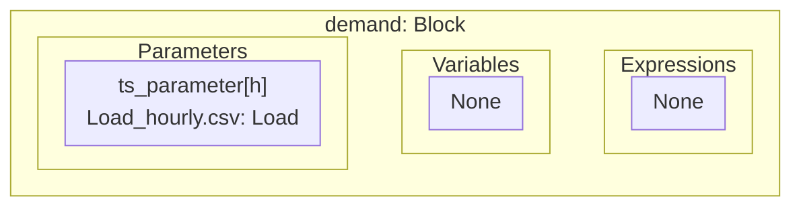

| Member | Kind | Mathematical meaning / units | Input provenance or definition |
| --- | --- | --- | --- |
| `ts_parameter[h]` | Param | $d_h$, MW | `Load_hourly.csv: Load`, indexed by `*Hour`; unscaled gross demand. |

No demand `alpha`, dispatch Var, or attached Expression is created.

## Nuclear

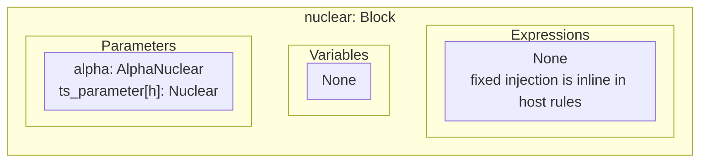

| Member | Kind | Mathematical meaning / units | Input provenance or definition |
| --- | --- | --- | --- |
| `alpha` | Param | $\alpha^{nuc}$, dimensionless | `scalars.csv: AlphaNuclear`. |
| `ts_parameter[h]` | Param | $\nu_h$, MW | `Nucl_hourly.csv: Nuclear`, indexed by `*Hour`. |

Fixed injection $G^{nuc}_h=\alpha^{nuc}\nu_h$ is used directly in formulas;
there is no nuclear generation Var or attached Expression.

## Other renewables

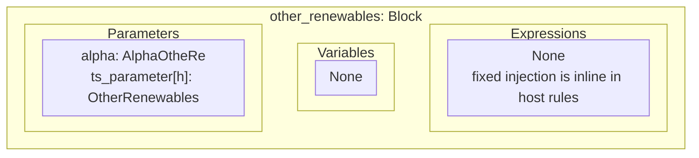

| Member | Kind | Mathematical meaning / units | Input provenance or definition |
| --- | --- | --- | --- |
| `alpha` | Param | $\alpha^{oth}$, dimensionless | `scalars.csv: AlphaOtheRe` (spelling intentional). |
| `ts_parameter[h]` | Param | $\omega_h$, MW | `otre_hourly.csv: OtherRenewables`, indexed by `*Hour`. |

Fixed injection $G^{oth}_h=\alpha^{oth}\omega_h$ is used directly in formulas;
there is no other-renewables generation Var or attached Expression.

## Imports

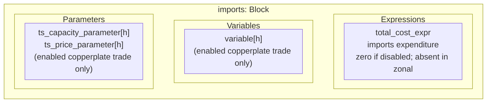

| Member | Kind | Mathematical meaning / units | Input provenance or definition |
| --- | --- | --- | --- |
| `ts_capacity_parameter[h]` | Param | $\bar\iota_h$, MW | Enabled copperplate trade only: `Import_Cap.csv: Imports`, indexed by `*Hour`. |
| `ts_price_parameter[h]` | Param | $c^{imp}_h$, USD/MWh | Enabled copperplate trade only: `Import_Prices.csv: Imports_price`, indexed by `*Hour`. |
| `variable[h]` | Var | $M_h\ge0$, MW | Enabled copperplate trade only; bounded by hourly capacity. |
| `total_cost_expr` | Expression | $Z^{imp}$, USD | Copperplate: $\sum_hc^{imp}_hM_h$ when enabled, constant zero for `NotModel`. Not created in zonal mode. |

## Exports

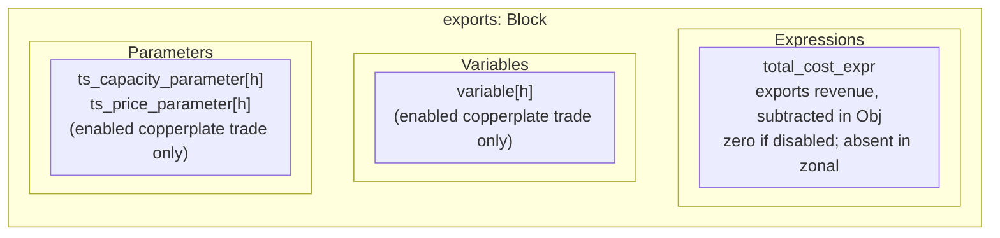

| Member | Kind | Mathematical meaning / units | Input provenance or definition |
| --- | --- | --- | --- |
| `ts_capacity_parameter[h]` | Param | $\bar\xi_h$, MW | Enabled copperplate trade only: `Export_Cap.csv: Exports`, indexed by `*Hour`. |
| `ts_price_parameter[h]` | Param | $c^{exp}_h$, USD/MWh | Enabled copperplate trade only: `Export_Prices.csv: Exports_price`, indexed by `*Hour`. |
| `variable[h]` | Var | $X_h\ge0$, MW | Enabled copperplate trade only; bounded by hourly capacity. |
| `total_cost_expr` | Expression | $Z^{exp}$, USD | Copperplate: $\sum_hc^{exp}_hX_h$ when enabled, constant zero for `NotModel`. Not created in zonal mode. |

`CapacityPriceNetLoadFormulation` additionally uses the **host** binary
`aux_imp_exp_binary_variable`; big-M $10^6$ MW and sign tolerance $10^{-6}$ MW
are code constants, not Pyomo Params or CSV inputs.
`WithoutNetLoadConstraints` uses only the capacity and price components.
See [external trade constraints](sdom_math_formulation.md#import-and-export-constraints).

## Reserves

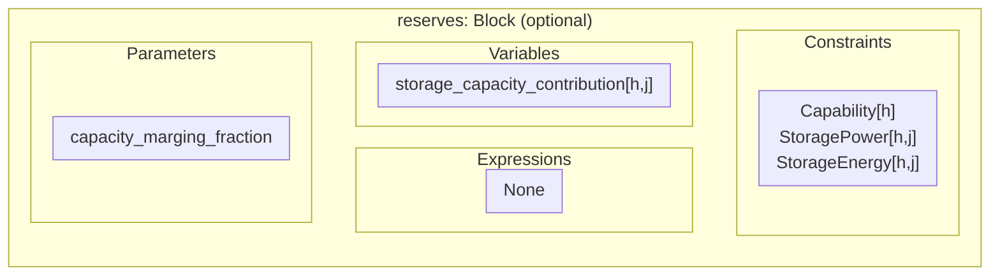

| Member | Kind | Mathematical meaning / units | Input provenance or definition |
| --- | --- | --- | --- |
| `capacity_marging_fraction` | Param | $m\ge0$, dimensionless | Optional `scalars.csv: capacity_marging_fraction`, default `0.0`; the historical spelling is the actual API/input name. |
| `storage_capacity_contribution[h,j]` | Var | $C^{stor}_{jh}\ge0$, MW | Credited storage supply, bounded by installed discharge power and beginning-of-hour SOC; no new input column. |

Only `formulations.csv` row `Component=Reserves`,
`Formulation=CapacityMarginFormulation` creates this block. It has no attached
Expressions. Zero margin still activates the hourly adequacy constraints.
In zonal mode each area has its own block; scheduled net line imports count
in the local requirement, but remote spare capability is not transferred
as reserve. See [capacity-margin equations](sdom_math_formulation.md#optional-hourly-capacity-margin)
and their [zonal counterpart](zonal_math_formulation.md#optional-local-capacity-margin).

## Resiliency

The optional `resiliency` block has **no Params, Vars, or Expressions**.
With `with_resilience_constraints=True`, the copperplate host instead owns
`LoadShed`, `EUE_max`, `PCLS_Constraint`, and `MaxEUE_Constraint`.

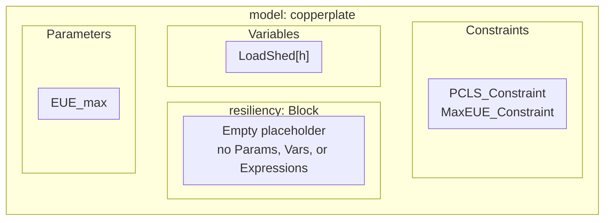

The aggregate served-load constraint uses code constants `PCLS_TARGET=0.9`
and `CRITICAL_LOAD_PERCENTAGE=1`; neither is a CSV scalar or Pyomo Param.
These legacy limits do not connect `LoadShed` to `SupplyBalance` and are not
the probabilistic outage evaluator. See
[legacy resilience limits](sdom_math_formulation.md#legacy-aggregate-planning-resiliency).

## Zonal root

There is **no separate network Block**. These components belong directly to
the zonal `ConcreteModel`, not to any `area[a]`.

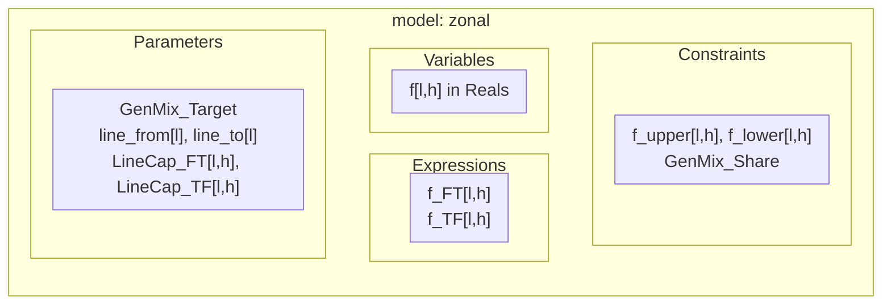

| Member | Kind | Mathematical meaning / units | Input provenance or definition |
| --- | --- | --- | --- |
| `A` | Set | $\mathcal A$, areas | Optional `areas.csv: area_id`, otherwise inferred from tagged columns and row-oriented `area_id` columns. |
| `area[a]` | Block | One technology host per $a$ | Indexed by `A`; owns the local blocks above. |
| `h` | Set | $\mathcal H$, one-based hours | Shared effective model horizon; each host has an equivalent local hour set. |
| `GenMix_Target` | Param | $\tau$, clean-generation fraction | `scalars.csv: GenMix_Target`; mutable system-wide target. |
| `L` | Set | $\mathcal L$, lines | `interconnections.csv: line_id`. |
| `line_from[l]` | Param | $\operatorname{from}(\ell)$, area identifier | `interconnections.csv: from_area`, keyed by `line_id`. |
| `line_to[l]` | Param | $\operatorname{to}(\ell)$, area identifier | `interconnections.csv: to_area`, keyed by `line_id`. |
| `L_in[a]` | Set | $\mathcal L_{in}(a)$ | Derived from `line_to`; stored orientation, independent of actual flow sign. |
| `L_out[a]` | Set | $\mathcal L_{out}(a)$ | Derived from `line_from`. |
| `LineCap_FT[l,h]` | Param | $\overline F^{FT}_{l,h}$, MW | `LineCap_FT.csv: <line_id>`, indexed by `*Hour`. |
| `LineCap_TF[l,h]` | Param | $\overline F^{TF}_{l,h}$, MW | `LineCap_TF.csv: <line_id>`, indexed by `*Hour`. |
| `f[l,h]` | Var | $f_{l,h}\in\mathbb R$, MW | Signed flow, positive from `line_from` to `line_to`; explicit capacity constraints, no direct Var bounds. |
| `f_FT[l,h]` | Expression | $f_{l,h}$, MW | Exactly `f[l,h]`, **not** a clipped nonnegative forward flow. |
| `f_TF[l,h]` | Expression | $-f_{l,h}$, MW | Exactly `-f[l,h]`, **not** a separate reverse-flow decision. |

`f_upper` and `f_lower` enforce asymmetric directional capacities.
`GenMix_Share` aggregates clean and total generation across all hosts;
flows are not generation and are not counted again. `Obj` is the single
system objective. See [network equations](zonal_math_formulation.md#network-constraints).

## Inspecting actual ownership

This example lists only directly owned fields, avoiding accidental duplicate
counts when traversing nested blocks. It needs no solver.

```python
from pathlib import Path

import pyomo.environ as pyo

from sdom import initialize_model, load_data

data = load_data(str(Path("Data") / "zonal_test"))
model = initialize_model(data, n_hours=24)

for block in [model, *model.component_data_objects(pyo.Block, descend_into=True)]:
    print(block.name)
    for kind in (pyo.Set, pyo.RangeSet, pyo.Param, pyo.Var, pyo.Expression):
        for component in block.component_objects(kind, descend_into=False):
            print(f"  {kind.__name__}: {component.local_name}")
```

The construction entry point is `optimization_main.initialize_model`;
`initializations` builds shared sets and host Params;
`models/formulations_*.py` populate technology/network fields;
`models/models_utils.py` supplies profile and common cost/budget helpers.
The [model-builder API](../api/models.md) links those source-backed functions.
